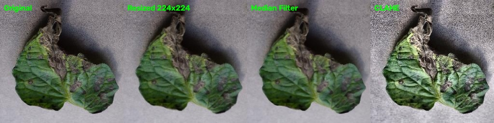

# Tomato Disease Detection Using Image Processing

## College MINI Project

* **Project Type**: College MINI Project
* **Domain**: Image Processing / Computer Vision
* **Team Size**: 2

## Project Objective

This project is a tomato leaf image classification system designed to identify three conditions from tomato leaf images:

1. Early Blight
2. Healthy
3. Late Blight

The project focuses primarily on **Image Processing / Computer Vision**, with Machine Learning / Deep Learning used as a supporting technique for image classification.

The final application is intended as an AI-assisted image-based screening prototype, not as professional agricultural diagnosis.

## Dataset Work Completed
 
For the current MINI Project scope, three classes were selected:
 

| Class       | Total Images |
|---|---|
|Early Blight | 1,000        |
| Healthy     | 1,591        |
|Late Blight  | 1,909        |
| Total       | 4,500        |

All 4,500 selected images are being used in the project dataset.
 

### Dataset Split

The dataset has been divided into three separate subsets:

| Class | Train | Validation | Test | Total
|--|--|--|--|--|
| Early Blight| 700 | 150 | 150 | 1,000 |
| Healthy | 1,114 | 239 | 238 | 1,591 |
| Late Blight | 1,336 | 286 | 287 | 1,909 |
| Total | 3,150 | 675 | 675 | 4,500 |

The split is approximately 70% Training / 15% Validation / 15% Testing.
 
Meaning of the folders
1. train/ — images used for model learning.
2. validation/ — images used during model development and tuning.
3. test/ — held-out images used for final evaluation.
The three subsets must remain independent to avoid data leakage.

## Work Completed So Far

### 1. Dataset Preparation

- Selected three tomato leaf classes.
- Prepared a dataset of 4,500 images.
- Organized the images into training, validation, and testing subsets.
- Maintained separate folders for each class.

### 2. Image Processing with OpenCV

A reusable preprocessing module has been implemented in `preprocessing/image_processor.py`.

The module supports:

- **Image loading:** Loads images using OpenCV and checks for missing or unreadable files.
- **Image resizing:** Resizes images to 224 × 224 pixels by default.
- **Noise reduction:** Provides optional median filtering with a kernel size of 3.
- **Contrast enhancement:** Provides optional CLAHE (Contrast Limited Adaptive Histogram Equalization) on the lightness channel in LAB color space.
- **Combined preprocessing:** Supports optional filtering and contrast enhancement before resizing.

The default preprocessing pipeline loads an image, resizes it to the configured dimensions, and returns a three-channel image in OpenCV's BGR format with `uint8` pixel values. Optional enhancements are disabled by default and should be configured according to the final model's requirements.

The module has passed syntax and functional checks using a sample dataset image, including checks of its output shape and data type.

### Preprocessing Comparison

The following image compares the original sample with its resized, median-filtered, and CLAHE-enhanced versions.

This comparison demonstrates the visual effects of the selected image-processing operations. It is a qualitative illustration only; it does not establish that preprocessing improves classification accuracy.

# Current Technology Stack

- Python
- OpenCV
- NumPy
- Pillow
- Streamlit
- Jupyter Notebook
- PyTorch (planned for model integration, subject to the final model implementation)
- Git and GitHub
- Visual Studio Code

# Next Development Steps

### 1. Build the Streamlit WebApp

- Create the application interface in the `webapp/` directory.
- Add an image-upload option for tomato leaf images.
- Display the uploaded image and its preprocessed preview.
- Add suitable validation and error handling for unsupported or unreadable files.

### 2. Integrate the Trained Model

- Confirm the model architecture, input dimensions, and preprocessing requirements.
- Integrate the saved model artifact once model training is complete.
- Connect the image-processing module to the model inference pipeline.
- Display the predicted class and confidence score only when supported by the model output.

### 3. Test the Complete Pipeline

- Test image upload, preprocessing, and prediction.
- Handle invalid files and inference errors.
- Check that the same required preprocessing is applied during model training and inference.
- Keep the test dataset separate from training and model tuning.

### 4. Evaluate the Model

Once training and evaluation are completed, report appropriate metrics, such as:

- Accuracy
- Precision
- Recall
- F1-score
- Confusion matrix

No model accuracy or classification-performance claims are made at this stage because verified training and evaluation results are not yet available.

## Project Status

- **Dataset preparation:** Completed
- **Image-processing module:** Implemented and functionally tested
- **Preprocessing comparison:** Generated
- **Streamlit WebApp:** Next development stage
- **Model integration:** Pending confirmation of the trained model and its requirements
- **Final evaluation:** Pending model training and testing